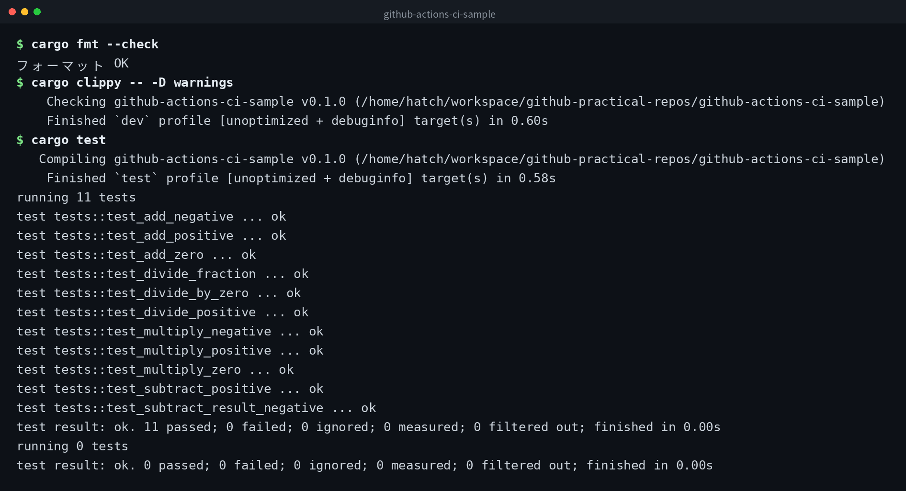

English | [日本語](ja/README.md) | [한국어](ko/README.md)


# github-actions-ci-sample

A minimal sample where automated tests run via GitHub Actions. It consists of a calculator library written in Rust and its unit tests.

## Demo



## How CI Works

When a push or pull request is made to the `main` branch, GitHub Actions automatically starts and runs the following 3 steps in order:

1. `cargo fmt --check` to verify code formatting
2. `cargo clippy -- -D warnings` to run static analysis
3. `cargo test` to run unit tests

If any step fails, the entire CI run fails.

## Running Tests Locally

```bash
# Rust toolchain is required
rustc --version

# Run tests
cargo test

# Check formatting
cargo fmt --check

# Static analysis
cargo clippy -- -D warnings
```

## CI Badge


To add this badge to your README, use the following Markdown:

```markdown

```

## Clone

```bash
git clone https://github.com/mivork/github-actions-ci-sample.git
```
