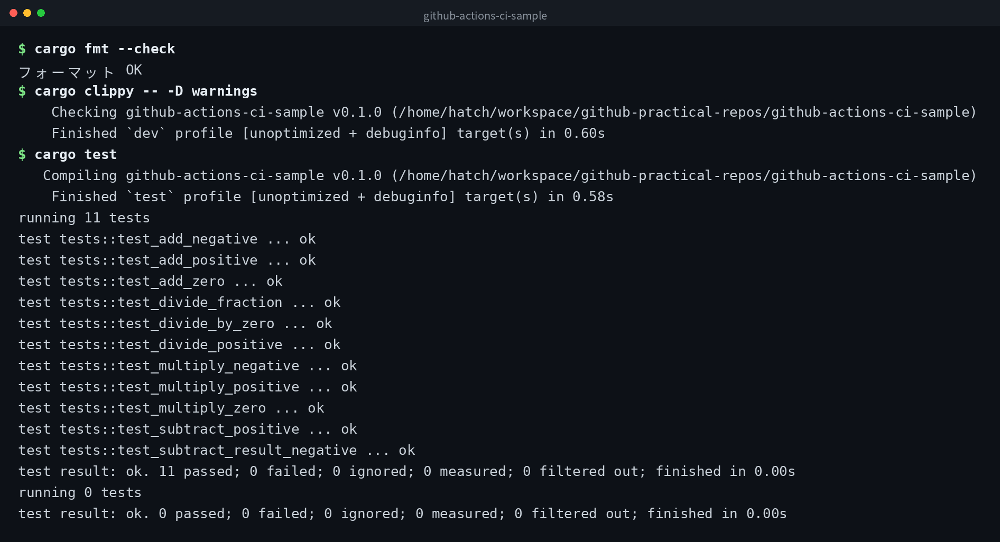

[English](../README.md) | 日本語 | [한국어](../ko/README.md)


# github-actions-ci-sample

GitHub Actions で自動テストが回る最小構成のサンプルです。
Rust で書かれた計算ライブラリと、そのユニットテストで構成されています。

## デモ



## CI の仕組み

`main` ブランチへの push または pull request が作成されると、GitHub Actions が自動的に起動します。
以下の 3 ステップを順に実行します。

1. `cargo fmt --check` でコードフォーマットを確認
2. `cargo clippy -- -D warnings` で静的解析を実行
3. `cargo test` でユニットテストを実行

いずれかのステップが失敗すると CI 全体が失敗になります。

## ローカルでのテスト実行

```bash
# Rust ツールチェインが必要
rustc --version

# テストの実行
cargo test

# フォーマットチェック
cargo fmt --check

# 静的解析
cargo clippy -- -D warnings
```

## CI バッジ


README にバッジを貼る場合は、以下の Markdown を使用してください。

```markdown

```

## クローン

```bash
git clone https://github.com/mivork/github-actions-ci-sample.git
```
