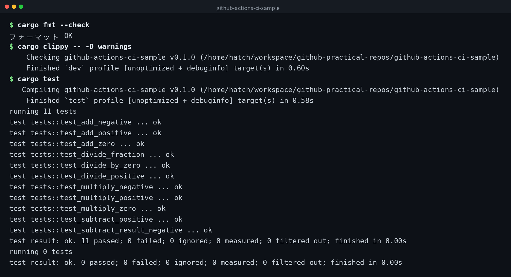

[English](../README.md) | [日本語](../ja/README.md) | 한국어


# github-actions-ci-sample

GitHub Actions로 자동 테스트가 실행되는 최소 구성 샘플입니다. Rust로 작성된 계산 라이브러리와 유닛 테스트로 구성되어 있습니다.

## 데모



## CI 동작 방식

`main` 브랜치에 push 또는 pull request가 생성되면 GitHub Actions가 자동으로 시작됩니다. 다음 3단계를 순서대로 실행합니다.

1. `cargo fmt --check`로 코드 포맷 확인
2. `cargo clippy -- -D warnings`로 정적 분석 실행
3. `cargo test`로 유닛 테스트 실행

어느 단계라도 실패하면 CI 전체가 실패합니다.

## 로컬에서 테스트 실행

```bash
# Rust 툴체인이 필요합니다
rustc --version

# 테스트 실행
cargo test

# 포맷 확인
cargo fmt --check

# 정적 분석
cargo clippy -- -D warnings
```

## CI 배지


README에 배지를 추가하려면 다음 Markdown을 사용하세요.

```markdown

```

## 클론

```bash
git clone https://github.com/mivork/github-actions-ci-sample.git
```
